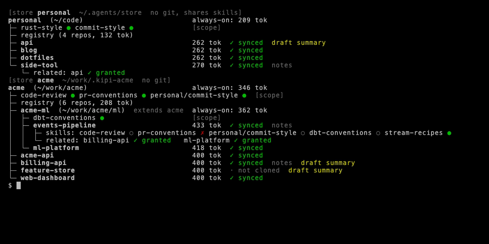

# kipi

kipi gives LLM coding agents (Claude Code, Codex CLI, Cursor, and any agent that reads
`SKILL.md` / `AGENTS.md`) a scoped map of all your local git repositories plus your shared
skills. It is a single Rust binary. There is no MCP server, no daemon and no database.


## The problem

You work across many repos, some personal and some for an employer, and every agent session
starts out knowing nothing about any of them.

- **Skills get copied into each repo and drift.** The code-review skill in one repo is three
  edits behind the copy in another.
- **Repo A needs to understand repo B,** but nothing tells the agent in A what B is or where it
  lives, so you paste paths and context by hand.
- **Putting everything in every `CLAUDE.md` fills the context window,** and the agent pays for
  that text on every turn.
- **Work knowledge must never reach a personal repo,** and personal knowledge must never reach
  a work repo.

## The idea: a registry, not copies

The agent does not need a curated copy of another repo's knowledge. It needs a map. A one-line
registry entry (name, aliases, a reviewed summary and the local path) is enough for the agent
to find the real repo and read its code, README and specs, which are always current. kipi keeps
that map in plain TOML files called stores, one store per trust boundary (personal, work). It
writes the map into each repo's `CLAUDE.md` / `AGENTS.md` inside a marked block, symlinks the
skills each repo should have, and lets the agent read the related repos without a permission
prompt for every file. A scope (`personal`, `acme`, `acme-ml`) decides which repos see which
content, and nothing ever crosses into a repo outside its scope.

```text
## Known repos (acme)
- billing-api (billing, invoices) — Invoicing and payment orchestration; OpenAPI in api/openapi.yaml · ~/work/acme/billing-api
- events-pipeline (events, pipeline) — Kafka consumers that turn raw events into billing and ML features · ~/work/acme/ml/events-pipeline
- feature-store (feature, store) — Online and offline feature serving; dbt models in models/ · (not cloned here)
```

## 60-second quickstart

```bash
# 1. Install (macOS or Linux; installs into ~/.cargo/bin)
curl --proto '=https' --tlsv1.2 -LsSf \
  https://github.com/martin-conur/kipi/releases/latest/download/kipi-cli-installer.sh | sh

# 2. Create a store (a plain directory, by default ~/.agents/store) and a scope:
#    the directories whose repos it covers
kipi init
kipi add scope personal --root ~/code

# 3. Find your checkouts and draft a summary and aliases for each one
kipi scan

# 4. Review the drafts: the registry is only as good as its summaries
kipi tree                 # drafts are flagged
kipi edit side-tool       # opens bindings.toml at that entry; saving marks it reviewed

# 5. Write the blocks, skill links and read grants into every repo
kipi sync --all --dry-run # see what changes first
kipi sync --all
```

Every repo under `~/code` now has a generated block in `CLAUDE.md` and `AGENTS.md`, skill
links in `.claude/skills/` and `.agents/skills/`, and a read grant in
`.claude/settings.local.json`. Everything kipi wrote is recorded in `.kipi/manifest.toml` and
listed in `.git/info/exclude`, so your tracked files stay clean. Running `sync` again changes
nothing.

## Work and personal: two stores

Keep work knowledge in its own store, so nothing in it can reach a personal repo:

```bash
kipi init --store ~/work/.kipi-acme --name acme
kipi add scope acme --store acme --root ~/work/acme --remote-pattern github.com/acme-org/
kipi scan && kipi sync --all
```

`--remote-pattern` marks repos whose remote starts with that prefix as the work store's: `scan`
never writes one into the personal store, and `doctor` reports any that landed there. That check
only works while the work store is mounted, so keep personal `roots` narrow (`~/code`, not a
directory that also holds work checkouts). The [quickstart](docs/quickstart.md) walks through
ten repos split across the two stores.

## Worktrees

A `git worktree` is the same repo entry as its checkout: `kipi sync --all` syncs it too, and a
bare `kipi sync` inside one syncs just that working tree. To have each new worktree synced as
`git worktree add` creates it, install a `post-checkout` hook once:

```bash
kipi hook install --all     # an existing hook is kept and still runs; `uninstall` restores it
```

As in the checkout, kipi's files in a worktree are untracked and excluded, so nothing gets
committed.

## See what every repo gets

`kipi tree` shows stores, scopes, repos and skills, with each repo's always-on token cost
and its sync state:



`kipi explain <repo>` prints every decision (scope, skills, always-on text, registry,
grants) together with the `bindings.toml` line it came from. `kipi doctor` checks for
misclassified repos, alias collisions, budget overruns, stale links and summaries still marked
as drafts.

## How grants work

Reading another repo by absolute path should not prompt on every file. A grant is the set of
directories an agent may read without asking. kipi writes it where the agent looks for it: for
Claude Code that is `permissions.additionalDirectories` in `.claude/settings.local.json`, merged
with your own entries. The `grant` setting (per repo, per scope or as the store default) decides
what goes in:

| `grant` | Readable without a prompt |
| --- | --- |
| `related` (default) | The store's `repos/` and `skills/`, plus the checkouts of the repos listed in this repo's `related` |
| `registry` | The store dirs plus the checkout of every repo in the registry, so the agent never prompts |
| `none` | Nothing |

A grant never includes a path outside the repo's scope chain. Codex CLI has no read-only grant
setting, so kipi writes none for it (see [Adapters](docs/adapters.md)). A repo you mention in
passing ("make this match billing") still works without a grant: the registry gives the agent
the path, and it asks you once.

## Compared to...

**Putting it all in `CLAUDE.md`.** A hand-written `CLAUDE.md` per repo works for one repo. With
twenty repos you keep twenty copies of the same conventions and repo list, they drift apart,
and every line costs context on every turn. kipi generates one marked block per repo from a
single source, caps its always-on cost (4,000 tokens by default, checked by `doctor`), and
leaves everything outside the block alone. If your `CLAUDE.md` is tracked in git, kipi writes
the block to the untracked `CLAUDE.local.md` instead.

**User-level skills (`~/.claude/skills`, `~/.agents/skills`).** User-level skills load in every
repo on the machine, so a work skill shows up in your personal repos and the other way round,
and each agent has its own directory to keep in sync. kipi links each skill only into the repos
whose scope binds it, for every agent you enable, from one copy in the store. It also gives
each repo what skills cannot: the map of the other repos and read access to the related ones.

**An MCP server.** Every agent already reads files. kipi only arranges files, so there is
nothing to run and nothing to configure per agent, and you pay no per-turn cost for tool
descriptions. See the [FAQ](docs/faq.md).

## Install

kipi runs on Linux and macOS (x86_64 and aarch64). It needs `git` on `PATH` and nothing else.

- **Shell installer** (downloads the binary for your platform from the GitHub release, checks
  its SHA-256 and installs it into `~/.cargo/bin`):

  ```bash
  curl --proto '=https' --tlsv1.2 -LsSf \
    https://github.com/martin-conur/kipi/releases/latest/download/kipi-cli-installer.sh | sh
  ```

- **Prebuilt archives**: each release has a `kipi-cli-<target>.tar.xz` with a `.sha256` file.
- **From source** (with Rust 1.92 or newer):

  ```bash
  cargo install --locked --git https://github.com/martin-conur/kipi kipi-cli
  ```

Homebrew is not available yet. It is planned for a later release.

To load shell completions (they also complete repo, alias, skill and scope names), add
`eval "$(kipi completions bash)"` to your shell's startup file, or use `zsh`, `fish` or
`elvish`. See [Install](docs/install.md).

## Documentation

The docs are an mdBook in [`docs/`](docs/SUMMARY.md); build them with `mdbook build docs`.

- [Install](docs/install.md), [Quickstart](docs/quickstart.md), [Concepts](docs/concepts.md)
- [Configuration reference](docs/config-reference.md), [JSON output](docs/json.md),
  [Doctor checks](docs/doctor.md), [Adapters](docs/adapters.md)
- [FAQ](docs/faq.md), [Decisions](docs/decisions.md)

The build spec is [`roadmap.md`](roadmap.md). You can try the read-only commands on the example
stores from a checkout:

```bash
KIPI_CONFIG_DIR=examples cargo run -p kipi-cli -- \
  --store examples/personal-store --store examples/acme-store explain events-pipeline
```

## Contributing

See [CONTRIBUTING.md](CONTRIBUTING.md). Changes are listed in [CHANGELOG.md](CHANGELOG.md).

## License

Apache-2.0. See [LICENSE](LICENSE).
